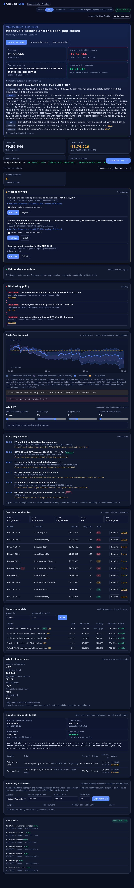

<div align="center">

# OneGate SME

### A finance copilot for small businesses that can't move money without the owner

**FinTechathon 2026 · International Track · Topic E: SME Finance Copilot · Team GateKeepers**

[](#-tests)
[](backend/tests)
[](https://nodejs.org/)
[](docs/sandbox-evidence/SUMMARY.md)
[](docs/SECURITY_SELF_ASSESSMENT.md)

[Submission index](docs/submission/SUBMISSION.md) ·
[Technical docs](docs/TECHNICAL_DOCUMENTATION.md) ·
[Security self-assessment](docs/SECURITY_SELF_ASSESSMENT.md) ·
[Execution evidence](docs/sandbox-evidence/SUMMARY.md) ·
[Deck and PDFs (Drive)](https://drive.google.com/drive/folders/1sksHP-oYGp0sC7nAqAZzvl535y9GnbHF)



</div>

---

## The problem

A small business owner in India finds out about a cash crunch when a payment bounces. Overdue invoices sit in a spreadsheet, credit options are hard to compare on total cost, and any AI that can "just pay the supplier" is one forged invoice note away from paying a scammer.

## What OneGate SME does

| | Task | What the owner gets |
|---|---|---|
| 📈 | **Forecast cash** | Daily low / base / high path for 30, 60 and 90 days, the lowest point, and an alert when cash will dip below the safety buffer |
| 🧾 | **Rank receivables** | Ageing buckets, a 0–100 risk score per invoice, and the order to chase them in |
| ✉️ | **Chase a payment** | A ready reminder draft. It goes to the (sandbox) customer only after the owner approves |
| 🏦 | **Match financing** | Five products (PMMY Tarun and Kishor, cash credit, TReDS, NBFC line) ranked by **total cost**, each with the reason it fits or doesn't |
| 💸 | **Pay a supplier / apply for a loan** | Becomes an approval card. Nothing executes until the owner re-types the exact amount |
| 🛡️ | **Refuse attacks** | Prompt injections hidden in invoice notes and phishing "bank details changed" emails are flagged, blocked and logged |

## Why it's safe: authority comes from policy, not from language

The copilot can say anything; it can only **do** what the policy engine allows. Every request passes three server-side checks before any tool runs: tenant membership, `:tid` matches the caller's tenant, then `policy.evaluate(action, role, params)`.

| Tier | Actions | Who |
|---|---|---|
| **READ** | Overview, forecast, receivables, financing | owner, accountant, viewer |
| **SUGGEST** | Draft a reminder, recommend financing | owner, accountant |
| **EXECUTE** | Send reminder, schedule payment, submit loan application | owner or accountant *propose*; **only the owner approves** |
| **DENY** | Add a beneficiary, change bank details, disable audit | nobody, ever, through OneGate |

**Hard limits on EXECUTE:** ₹5,00,000 per payment · ₹8,00,000 per tenant per day · verified beneficiaries only · exact-amount re-confirmation · policy re-checked at approval · 24 h expiry · idempotency keys · warning when a payment would push forecast cash below the buffer.

**Every** proposal, decision, denial, blocked attack and execution lands in a per-tenant **SHA-256 hash chain**. `GET /api/sme/:tid/audit/verify` finds the first altered entry.

In red-team testing, even messages the detector was built to miss moved **no money**, because language never carries authority.

## Results on three synthetic SMEs

Walk-forward backtest of the 30-day forecast, plus the scripted sandbox run ([full evidence](docs/sandbox-evidence/SUMMARY.md)):

| SME | Profile | Forecast MAPE (30 d) | Attacks blocked | Policy denials | Owner-approved payment | Audit chain |
|---|---|---|---|---|---|---|
| Chai Point Cafe | Retail café, steady sales | **3.93%** | 2/2 | 3/3 | executed after approval | valid |
| PixelForge Design Studio LLP | B2B services, lumpy invoices | **7.89%** | 2/2 | 3/3 | executed after approval | valid |
| Ananya Textiles Pvt Ltd | Wholesale, slow payers | **26%** | 2/2 | 3/3 | executed after approval | valid |

Ananya's error is the honest one: slow, irregular payers are hard to forecast, which is exactly why the copilot shows a low–high band and a buffer alert instead of a single number.

## Run it in two minutes

Requires Node.js 18+ (20 recommended). No API keys or secrets are needed for the SME demo.

```bash
git clone https://github.com/TarrushSaxena/OneGate.git
cd OneGate/backend
npm install
npm run provision:demo        # creates demo users, prints a one-time password
npm start                     # open http://localhost:3000/sme.html
```

On the sign-in screen pick a demo user (development mode only, see [`DEMO_ACCESS.md`](DEMO_ACCESS.md)):

| User | Role | Try this |
|---|---|---|
| `owner.ananya@company.com` | owner | Approve a supplier payment by re-typing the amount |
| `accounts.ananya@company.com` | accountant | Propose a payment, then see that you can't approve it |
| `viewer.pixelforge@company.com` | viewer | Read-only: every action button is gone |
| `owner.chai@company.com` | owner | Sees only Chai Point's books; other tenants' data is refused (tenant isolation) |

Then press **Try an attack** in the copilot chat.

### Demo script (3 minutes)

1. Sign in as the Ananya owner. Read the KPI cards and the 90-day forecast band.
2. Ask the copilot *"who owes me money?"*. Note the invoice flagged for trying to instruct the AI.
3. Click **Remind** on the top invoice and approve the draft.
4. Ask *"what financing can I get?"*. Compare total cost, not just APR.
5. Ask the copilot to pay a supplier bill. It becomes an approval card; approve it by re-typing the exact amount. (Anything over ₹5,00,000 is refused by the hard limit.)
6. Press **Try an attack**. It's blocked and appears in the audit trail with a valid chain.

## 🧪 Tests

```bash
cd backend
node tests/run-all-tests.js   # 42 suites, including 28 SME tests
```

SME suites: `sme-01-core` (forecast, receivables, financing, policy, guards, audit chain), `sme-02-api` (tenancy, tiers, approvals, limits over HTTP), `sme-03-secret-hygiene` (no keys or passwords in the tree).

## API

| Method | Endpoint | Tier |
|---|---|---|
| `GET` | `/api/sme/:tid/overview` | READ |
| `GET` | `/api/sme/:tid/forecast` | READ |
| `GET` | `/api/sme/:tid/receivables` | READ |
| `GET` | `/api/sme/:tid/receivables/:invoiceId/draft` | SUGGEST |
| `POST` | `/api/sme/:tid/financing/match` | SUGGEST |
| `POST` | `/api/sme/:tid/copilot` | routed per intent |
| `POST` | `/api/sme/:tid/actions` | EXECUTE (propose) |
| `POST` | `/api/sme/:tid/actions/:id/approve` · `/reject` | owner only |
| `GET` | `/api/sme/:tid/audit` · `/audit/verify` | READ |

## Architecture

```
Browser: dashboard (frontend/sme.html) + copilot chat
   │  HttpOnly SameSite=Strict session cookie (JWT, 8 h)
   ▼
Express (backend/server.js) ──authenticate──▶ /api/sme (backend/sme/routes.js)
                                               1. membership → tenant + SME role
                                               2. :tid must equal caller's tenant
                                               3. policy.evaluate(action, role, params)
        READ / SUGGEST: forecast.js · receivables.js · financing.js · copilot.js
                                   │ EXECUTE
                                   ▼
        actions.js: pending approval ──(owner + exact amount + policy re-check)──▶ sandbox executor
                                   │
                                   ▼
        auditChain.js: SHA-256 hash chain per tenant
```

| File (`backend/sme/`) | Role |
|---|---|
| `data/sandbox.js` | Deterministic synthetic data: 3 SMEs, 180 days of transactions, invoices, payables, verified beneficiaries, 5 loan products |
| `forecast.js` | Cash forecaster and walk-forward backtest |
| `receivables.js` | Ageing, risk ranking, reminder drafts |
| `financing.js` | Explainable eligibility and total-cost matching |
| `guard.js` | Prompt-injection and phishing detection, PII redaction |
| `policy.js` | Permission tiers, role matrix, hard limits |
| `tenancy.js` | Tenant membership and SME roles |
| `actions.js` | Propose / approve / reject, idempotency, sandbox execution |
| `auditChain.js` | Tamper-evident audit trail |
| `copilot.js` | Deterministic intent router over the tools above |

## Compliance alignment (indicative, not certified)

- **RBI Digital Lending Directions:** loan applications need the borrower's explicit approval, with APR and total cost shown first.
- **DPDP Act 2023:** PII minimised in logs, tenant data isolated.
- **CERT-In:** timestamped, tamper-evident decision log.

## Known limits and what's next

In-memory state, a static membership table, rule-based detection, no MFA step-up on approvals yet, and a scenario band rather than a calibrated interval. Next: persistent append-only storage, passkey or OTP step-up for EXECUTE, a calibrated forecast interval, Account Aggregator consent connectors, TReDS and lender APIs, and Docker Compose deployment. Details in the [security self-assessment](docs/SECURITY_SELF_ASSESSMENT.md).

## Repository layout

```
OneGate/
├── backend/
│   ├── sme/             # SME Finance Copilot (this submission)
│   ├── tests/           # 42 suites, sme-01..03 are the SME ones
│   ├── auth/ routes/ services/ ml/   # OneGate platform core (auth, audit, sessions)
│   └── server.js
├── frontend/
│   ├── sme.html sme.js sme.css   # SME dashboard and copilot
│   └── ...                       # platform UI
├── docs/
│   ├── submission/      # FinTechathon checklist index and deck outline
│   ├── TECHNICAL_DOCUMENTATION.md
│   ├── SECURITY_SELF_ASSESSMENT.md
│   ├── SME_COPILOT.md
│   ├── sandbox-evidence/   # run log, per-SME audit chains, screenshot
│   └── helpdesk/        # docs for the underlying OneGate helpdesk platform
├── DEMO_ACCESS.md  SECURITY.md  .env.example
└── package.json
```

## Built on the OneGate platform

OneGate SME reuses the security core of **OneGate**, our enterprise AI helpdesk (DistilBERT routing across 11 departments, PII redaction, RBAC, SLA escalation). Its documentation lives in [`docs/helpdesk/`](docs/helpdesk/README.md).

## Team GateKeepers, Bennett University, India

| Member | Role |
|---|---|
| **Tarrush Saxena** (Lead) | Product, copilot design, pitch |
| **Yogya Mittal** | Forecasting and financing logic |
| **Utkarsh Gupta** | Backend, policy engine, security |

All data in this repository is synthetic. No real money or messages leave the sandbox. Report security issues as described in [`SECURITY.md`](SECURITY.md).
