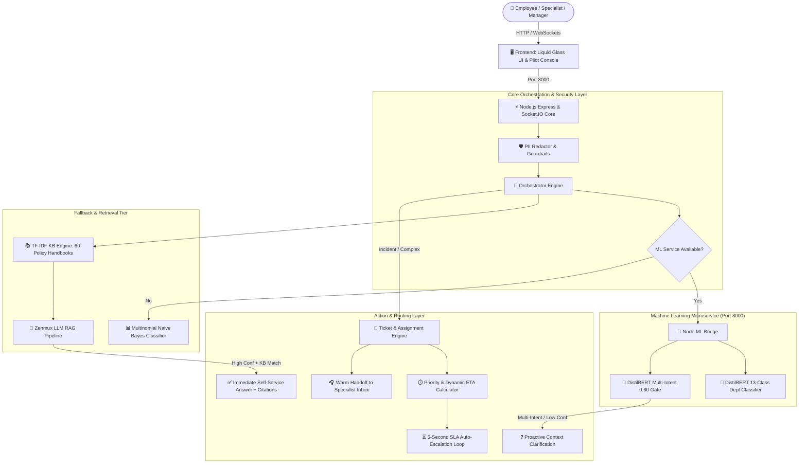

# 🚪 OneGate — One Front Door for Everything
### Enterprise Autonomous Multi-Agent AI Helpdesk & Workplace Operating System

[](https://nodejs.org/)
[](https://www.python.org/)
[](https://fastapi.tiangolo.com/)
[](https://pytorch.org/)
[](https://socket.io/)
[](https://zenmux.ai/)
[](https://github.com/TarrushSaxena/OneGate)
[](https://git-lfs.github.com/)

> **OneGate** replaces the maze of fragmented enterprise portals, email chains, and Slack confusion with a unified **"One Front Door"** conversational AI experience. Driven by fine-tuned **DistilBERT** NLP classifiers, a **TF-IDF + Cosine Similarity** Knowledge Base of 60 corporate policy handbooks, and a **Zenmux LLM RAG engine**, OneGate provides instant self-service resolutions, autonomous routing across **11 enterprise departments**, zero-PII data redaction, queue-aware dynamic ETAs, and warm specialist handoffs.

---

## 📑 Table of Contents

- [🌟 System Highlights & Key Features](#-system-highlights--key-features)
- [🏗️ High-Level System Architecture](#️-high-level-system-architecture)
- [🤖 Machine Learning & AI Pipeline](#-machine-learning--ai-pipeline)
- [🏢 11 Covered Enterprise Departments](#-11-covered-enterprise-departments)
- [🚀 Quick Start: How to Run on Any New Computer](#-quick-start-how-to-run-on-any-new-computer)
  - [1. Prerequisites](#1-prerequisites)
  - [2. Clone Repository (with Git LFS)](#2-clone-repository-with-git-lfs)
  - [3. Windows One-Click Quick Start](#3-windows-one-click-quick-start)
  - [4. macOS & Linux Quick Start](#4-macos--linux-quick-start)
  - [5. Manual Step-by-Step Installation](#5-manual-step-by-step-installation)
- [🔑 Credentials & Role Access Matrix](#-credentials--role-access-matrix)
- [⚙️ Environment Variables & Configuration](#️-environment-variables--configuration)
- [📡 API & Real-Time Socket.IO Reference](#-api--real-time-socketio-reference)
- [🧪 Testing & Quality Assurance](#-testing--quality-assurance)
- [📁 Project Directory Tree](#-project-directory-tree)

---

## 💹 NEW: OneGate SME Finance Copilot (FinTechathon 2026, Topic E)

A permission-tiered AI finance copilot for small businesses, built on OneGate's security core. It provides 30/60/90-day cash-flow forecasts, risk-ranked overdue receivables, reminder drafts, explainable financing matching, and sandbox payments and loan applications that **always require the owner's approval**. It adds prompt-injection and phishing defences, tenant isolation and a hash-chained audit log. Synthetic sandbox data only.

🖥️ Dashboard: `http://localhost:3000/sme.html` (after `npm run provision:demo`)

📄 Technical documentation: [`docs/TECHNICAL_DOCUMENTATION.md`](docs/TECHNICAL_DOCUMENTATION.md)

🛡️ Security self-assessment: [`docs/SECURITY_SELF_ASSESSMENT.md`](docs/SECURITY_SELF_ASSESSMENT.md)

➡️ Full docs: [`docs/SME_COPILOT.md`](docs/SME_COPILOT.md) · Evidence: [`docs/sandbox-evidence/SUMMARY.md`](docs/sandbox-evidence/SUMMARY.md) · Code: `backend/sme/`

---

## 🌟 System Highlights & Key Features

1. **One Front Door Simplicity**: Employees never have to guess which department to contact. A single unified chat window intelligently routes, deflects, or escalates every inquiry.
2. **Dual-Model Transformer ML Pipeline**:
   - **DistilBERT Sequence Classifier (13 classes)**: Classifies user requests directly into departmental domains with high precision.
   - **DistilBERT Multi-Intent Classifier (0.60 Gate)**: Flags complex queries spanning multiple topics to trigger proactive clarification loops without dead-ends.
3. **Resilient Dual-Tier Microservice Architecture**:
   - **Node.js / Express Core (Port 3000)**: Real-time WebSockets, SLA timers (5s tick loop), multi-factor assignment scoring, and session management.
   - **Python FastAPI ML Microservice (Port 8000)**: CPU/GPU PyTorch inference for sequence classification and multi-intent detection.
   - **Fault-Tolerant Naive Bayes Fallback**: If the Python microservice is offline or restarting, Node.js transparently falls back to an internal multinomial Naive Bayes classifier without any service downtime.
4. **Knowledge-Grounded LLM RAG Deflection**: Integrated with **Zenmux AI** (`dots-studio/dots3-note-prev`, `z-ai/glm-4.7-flash-free`) to deliver grounded answers with direct citations back to the 60 official policy handbook clauses.
5. **Bank-Grade PII & Security Redaction**: Automatic zero-leak redaction of credit cards (Visa, MasterCard, 15-digit Amex), SSNs, bank accounts, phone numbers, and credentials before records touch internal queues.
6. **Dynamic Queue-Aware ETA & SLA Timers**:
   - Formula: `ETA = (Ahead / OnlineAgents) * AvgHandling + AvgHandling` clamped to official department SLA windows.
   - Auto-escalation: If SLA deadlines approach or breach, tickets automatically elevate (`L1` ➔ `L2` ➔ `L3` ➔ `Manager`).
7. **Liquid Glass Aesthetic UI**:
   - Exclusively light mode, multi-stop specular reflection borders, rubber elastic motion physics (`cubic-bezier(0.34, 1.56, 0.64, 1)`), ambient lattice loaders, and full mobile + desktop responsiveness.

---

## 🏗️ High-Level System Architecture



---

## 🤖 Machine Learning & AI Pipeline

### 1. Dual DistilBERT Models
- **Department Classifier**: Fine-tuned on sequence classification across 13 domain categories (`IT`, `HR`, `Finance`, `Billing`, `CustomerSupport`, `Cybersecurity`, `DataAnalytics`, `InvestorRelations`, `Legal`, `Marketing`, `QualityAssurance`, `Facilities`, `Executive`).
  - Weights located at: `backend/ml/python_service/department_model/`
- **Multi-Intent Classifier**: Sequence classifier detecting whether an inquiry encompasses distinct orthogonal requests (e.g., *"My laptop won't turn on and also I need to approve an expense report"*).
  - Decision threshold: Frozen at `0.60`.
  - Weights located at: `backend/ml/python_service/multi_intent_model/`

### 2. Multi-Model Zenmux LLM Pipeline
- **API Provider**: OpenAI-compatible endpoint at `https://zenmux.ai/api/v1`
- **Primary Model**: `dots-studio/dots3-note-prev`
- **Fallback Models**: `z-ai/glm-4.7-flash-free`, `z-ai/glm-4.6v-flash-free`
- **API Key**: Read from `ZENMUX_API_KEY` in your local `.env` (never committed).

### 3. Knowledge Base & Grounding
- **Indexed Handbooks**: 60 articles spanning 11 department policy handbooks.
- **Search Engine**: In-memory TF-IDF vectorizer + Cosine Similarity ranker.
- **Grounding Gate**: Deflections require confidence > 0.65 and direct clause match; otherwise, the request transitions to specialist handoff.

---

## 🏢 11 Covered Enterprise Departments

| # | Department | Capabilities & Automated Scope |
|---|---|---|
| **1** | **IT Support** | Hardware provisioning, VPN, Wi-Fi, MFA reset, SSO, software licensing, printer setup. |
| **2** | **Human Resources (HR)** | PTO/Leave approval, benefits enrollment, maternity/paternity policy, employee conduct. |
| **3** | **Finance & Accounts** | Corporate cards, expense reimbursement, travel per diem, fiscal year accounting. |
| **4** | **Billing & Invoicing** | Client payment processing, invoice disputes, vendor purchase orders, payment terms. |
| **5** | **Customer Support** | Client escalations, Tier-2 routing, customer onboarding, feedback ticketing. |
| **6** | **Cybersecurity & InfoSec** | Phishing reports, SOC incident triage, lost ID badge deactivation, access token revocation. |
| **7** | **Data & Analytics** | BI dashboard access, database permissions, ETL pipeline inquiries, reporting requests. |
| **8** | **Investor Relations** | Quarterly earnings briefings, shareholder reports, investor inquiries, cap table disclosures. |
| **9** | **Legal & Compliance** | NDA requests, vendor contract review, regulatory disclosures, compliance audits. |
| **10** | **Marketing & Brand** | Brand guidelines, press release reviews, digital asset library access, logo permissions. |
| **11** | **Quality Assurance (QA)** | Bug triage, staging environment test passes, release sign-offs, regression alerts. |

---

## 🚀 Quick Start: How to Run on Any New Computer

Follow these steps to run OneGate on any computer (Windows, macOS, or Linux).

### 1. Prerequisites

Make sure the following runtimes are installed:
- **Node.js**: `v18.0.0` or higher (`v20.x` recommended) — [Download Node.js](https://nodejs.org/)
- **Python**: `3.9` through `3.12` — [Download Python](https://www.python.org/)
- **Git** with **Git LFS**: Required for tracking pre-trained PyTorch transformer weights (`*.safetensors`) — [Install Git LFS](https://git-lfs.github.com/)

Verify installations:
```bash
node -v
python --version   # or python3 --version
git-lfs version
```

---

### 2. Clone Repository (with Git LFS)

```bash
# 1. Initialize Git LFS once on your machine
git lfs install

# 2. Clone the repository
git clone https://github.com/TarrushSaxena/OneGate.git

# 3. Enter project directory
cd OneGate

# 4. Pull large model weights (if not automatically pulled)
git lfs pull
```

---

### 3. Windows One-Click Quick Start

If you are on Windows, you can launch everything in one step:

```powershell
# In PowerShell:
.\start-all.ps1
```
*This will open two windows: one running the Python DistilBERT microservice on port 8000, and the other running the Node.js Express server on port 3000.*

Open your browser to: **[http://localhost:3000](http://localhost:3000)**

---

### 4. macOS & Linux Quick Start

Make the shell scripts executable and run:

```bash
chmod +x *.sh

# Terminal 1: Start DistilBERT ML Microservice (Port 8000)
./start-ml.sh

# Terminal 2: Start Node.js Backend Server (Port 3000)
./start-backend.sh
```

Open your browser to: **[http://localhost:3000](http://localhost:3000)**

---

### 5. Manual Step-by-Step Installation

If you prefer installing dependencies manually step-by-step:

#### Step A: Install Backend Dependencies & Start Server
```bash
# From the repository root:
npm install

# (Optional: install backend-specific dependencies if running isolated)
cd backend && npm install && cd ..

# Start the Node.js Server
npm start
```
*The server will start at `http://localhost:3000`.*

#### Step B: Install Python ML Microservice (Optional but Recommended)
The backend automatically includes an in-memory Naive Bayes fallback classifier. To run with full GPU/CPU **DistilBERT Transformers**:

```bash
# Navigate to the Python ML microservice directory
cd backend/ml/python_service

# Create and activate virtual environment
python -m venv venv

# Windows:
.\venv\Scripts\activate
# macOS/Linux:
source venv/bin/activate

# Install requirements (PyTorch, Transformers, FastAPI, Uvicorn)
pip install -r requirements.txt

# Start ML Microservice
python -m uvicorn app:app --host 127.0.0.1 --port 8000 --reload
```
*The ML microservice will be live at `http://127.0.0.1:8000`. The Node.js server will automatically detect it and upgrade classification from Naive Bayes to DistilBERT.*

---

## 🔑 Credentials & Role Access Matrix

OneGate includes **28 pre-configured accounts** across 4 enterprise tiers with full RBAC isolation.

> **Universal Master Password for All Accounts:**  
> 🗝️ **`TestOnly!12345`**

### ⚡ Quick Demo Access
When visiting `http://localhost:3000/index.html`, click **Sign In** and use the **Quick Demo Access** dropdown to instantly log in as any role without typing passwords.

---

### 1. Executive / Main Managers (`/app/org`)
*Cross-department oversight, SLA heatmaps, employee roster inspection, audit trails.*

| Role | Name | Email | Password | Console Route |
|---|---|---|---|---|
| **Executive Director** | Executive Director | `director.exec@company.com` | `TestOnly!12345` | `/app/org` |
| **Global Operations Manager** | Global Operations Manager | `main.manager@company.com` | `TestOnly!12345` | `/app/org` |

---

### 2. Department Managers (`/app/department`)
*Department-scoped ticket queue, attendance swipe clock-ins, leave approval queue, workload balancing, department broadcast announcements.*

| Department | Manager Title | Work Email | Password |
|---|---|---|---|
| **IT Support** | IT Operations Head | `it.manager@company.com` | `TestOnly!12345` |
| **IT Support (Personal Lead)** | Tarrush Saxena | `tarrushsaxena@gmail.com` | `TestOnly!12345` |
| **Human Resources (HR)** | HR Director | `hr.manager@company.com` | `TestOnly!12345` |
| **Finance & Accounts** | Finance Controller | `finance.manager@company.com` | `TestOnly!12345` |
| **Billing & Invoicing** | Billing Operations Lead | `billing.manager@company.com` | `TestOnly!12345` |
| **Customer Support** | Customer Support Manager | `customersupport.manager@company.com` | `TestOnly!12345` |
| **Cybersecurity & InfoSec** | Chief InfoSec Officer | `cybersecurity.manager@company.com` | `TestOnly!12345` |
| **Data & Analytics** | Data Analytics Lead | `dataanalytics.manager@company.com` | `TestOnly!12345` |
| **Investor Relations** | IR Director | `investorrelations.manager@company.com` | `TestOnly!12345` |
| **Legal & Compliance** | General Counsel | `legal.manager@company.com` | `TestOnly!12345` |
| **Marketing & Brand** | Marketing VP | `marketing.manager@company.com` | `TestOnly!12345` |
| **Quality Assurance (QA)** | QA Director | `qualityassurance.manager@company.com` | `TestOnly!12345` |

---

### 3. Department Specialists (`/app/inbox`)
*Live ticket assignment workbench, status toggles (Online, Busy, Away, Offline), warm handoff notes.*

| Department | Specialist Name | Tier | Work Email | Password |
|---|---|---|---|---|
| **IT Support** | Priya Sharma | L3 Senior Lead | `priya.sharma@company.com` | `TestOnly!12345` |
| **IT Support** | Rahul Verma | L1 Frontline | `rahul.verma@company.com` | `TestOnly!12345` |
| **Human Resources** | Ananya Roy | L2 Specialist | `hr.support@company.com` | `TestOnly!12345` |
| **Finance & Accounts** | Vikram Mehta | L2 Specialist | `finance.support@company.com` | `TestOnly!12345` |
| **Billing & Invoicing** | Neha Gupta | L2 Specialist | `billing.support@company.com` | `TestOnly!12345` |
| **Customer Support** | Arjun Das | L2 Specialist | `customersupport.support@company.com` | `TestOnly!12345` |
| **Cybersecurity** | Kabir Rao | L3 Senior Lead | `cybersecurity.support@company.com` | `TestOnly!12345` |
| **Data & Analytics** | Sneha Patel | L2 Specialist | `dataanalytics.support@company.com` | `TestOnly!12345` |
| **Investor Relations** | Rohan Singhania | L2 Specialist | `investorrelations.support@company.com` | `TestOnly!12345` |
| **Legal & Compliance** | Meera Nambiar | L3 Senior Lead | `legal.support@company.com` | `TestOnly!12345` |
| **Marketing & Brand** | Aditya Sen | L2 Specialist | `marketing.support@company.com` | `TestOnly!12345` |
| **Quality Assurance** | Tanvi Joshi | L2 Specialist | `qualityassurance.support@company.com` | `TestOnly!12345` |

---

### 4. Employee Helpdesk Requester (`/app/chat`)
*One Front Door conversational AI chat, live SLA tracking, self-service deflection.*

| Role | Name | Department | Work Email | Password |
|---|---|---|---|---|
| **Employee** | Demo Employee | IT | `employee@company.com` | `TestOnly!12345` |

---

## ⚙️ Environment Variables & Configuration

The application comes pre-configured with ready-to-run defaults in `.env`.

| Variable | Description | Default Value in Repo |
|---|---|---|
| `PORT` | Node.js web server port | `3000` |
| `NODE_ENV` | Application runtime environment | `development` |
| `JWT_SECRET` | Secret key for signing session tokens | `ps18-development-secret-key-minimum-32-chars-long!` |
| `BCRYPT_ROUNDS` | Password hashing complexity rounds | `12` |
| `COMPANY_EMAIL_DOMAIN`| Permitted enterprise domain | `company.com` |
| `DEMO_MODE` | Enables quick demo login selector | `true` |
| `ZENMUX_API_KEY` | Zenmux OpenAI-compatible API key | *(not committed; set in your local `.env`)* |
| `ZENMUX_BASE_URL` | Zenmux API endpoint | `https://zenmux.ai/api/v1` |
| `ZENMUX_PRIMARY_MODEL`| Primary LLM inference model | `dots-studio/dots3-note-prev` |
| `ML_SERVICE_URL` | Python FastAPI microservice URL | `http://127.0.0.1:8000` |

---

## 📡 API & Real-Time Socket.IO Reference

### REST Endpoints

- `POST /api/auth/login`: Authenticate with work email & password. Issues JWT cookie + bearer token.
- `POST /api/auth/logout`: Clears session token.
- `GET  /api/auth/me`: Fetches profile of currently authenticated user.
- `POST /api/chat/message`: Send an inquiry through the One Front Door conversational pipeline.
- `GET  /api/policies`: Retrieve indexed corporate policy articles and link to handbook PDF.
- `GET  /api/policies/handbook.pdf`: Streams the complete master enterprise policy handbook.
- `GET  /api/pilot/tickets`: Fetches tickets filtered by user role and department.
- `POST /api/pilot/attendance/swipe`: Simulates an RFID door badge swipe for live clock-in.
- `POST /api/pilot/emergency/sos`: Instant emergency alert bypass directly to security and managers.
- `POST /api/pilot/badge/deactivate`: Deactivates lost/compromised RFID badge instantly.

### Real-Time WebSocket Events (`Socket.IO`)

- `ticket:created`: Broadcasts new ticket arrival to department specialists.
- `ticket:assigned`: Notifies assigned specialist with warm handoff payload.
- `ticket:status`: Updates employee on ticket triage, tier elevation, or resolution.
- `ticket:escalated`: Emitted when an SLA breach triggers tier elevation.
- `outage:announced`: Broadcasts major department outage banners to all online users.
- `dashboard:update`: Pushes updated queue depth, open tickets, and CSAT metrics every 5s.

---

## 🧪 Testing & Quality Assurance

OneGate includes an automated test harness validating all architectural requirements and specs.

```bash
# Run unit test
npm test

# Run the full test suite
node backend/tests/run-all-tests.js
```

---

## 📁 Project Directory Tree

```
OneGate/
├── backend/
│   ├── auth/                    # JWT authentication, session store, RBAC middleware
│   ├── data/                    # Knowledge base, policy handbooks, runtime accounts
│   ├── ml/
│   │   ├── classifier.js        # Multinomial Naive Bayes classifier fallback
│   │   ├── embeddings.js        # TF-IDF vectorizer & Cosine Similarity search engine
│   │   ├── sentiment.js         # Lexicon NLP priority & sentiment analyzer
│   │   └── python_service/      # Dedicated PyTorch / FastAPI microservice
│   │       ├── app.py           # FastAPI service endpoint (Port 8000)
│   │       ├── department_classifier.py
│   │       ├── department_model/ # DistilBERT weights (model.safetensors via Git LFS)
│   │       ├── multi_intent_classifier.py
│   │       ├── multi_intent_model/ # Multi-intent weights (model.safetensors via Git LFS)
│   │       └── requirements.txt # Python dependencies
│   ├── routes/                  # Express API routers (pilot, admin, auth)
│   ├── services/                # Orchestrator, LLM client, queue, SLA, assignment
│   ├── tests/                   # Native node:test acceptance suites
│   ├── package.json             # Backend Node.js dependencies
│   └── server.js                # Express & Socket.IO main server entrypoint
├── frontend/
│   ├── components/              # Reusable UI components (LatticeLoader, GhostFibers)
│   ├── pages/                   # Chat, specialist inbox, department, org consoles
│   ├── styles/                  # Liquid glass tokens, rubber motion easing
│   ├── app.js                   # Client-side router and state manager
│   ├── index.html               # Main single-page application entry
│   └── pilot.css                # Enterprise design system styles
├── docs/                        # Architecture specs, project reports, and handbooks
│   ├── screenshots/             # UI screenshots for presentation
│   └── PS18_Master_Project_Report.pdf # Comprehensive Hackathon Master Project Report
├── scripts/                     # Helper & provisioning scripts
├── .env                         # Pre-configured environment variables
├── .env.example                 # Environment variables template
├── .gitattributes               # Git LFS configuration for *.safetensors & *.bin
├── .gitignore                   # Ignores node_modules, virtualenvs, and test logs
├── package.json                 # Root script runner and dependencies
├── start-all.ps1                # Windows one-click dual-service launcher
├── start-backend.ps1            # Windows backend launcher
├── start-ml.ps1                 # Windows ML microservice launcher
├── start-backend.sh             # macOS/Linux backend launcher
├── start-ml.sh                  # macOS/Linux ML microservice launcher
├── DEPARTMENT_CREDENTIALS.md    # Complete login directory & passwords
├── ML_INTEGRATION_GUIDE.md      # Detailed ML microservice technical guide
└── README.md                    # Project documentation
```

---

## 📄 License & Ownership

Developed by **Tarrush Saxena** for the **PS18 Hackathon**.  
Repository: [https://github.com/TarrushSaxena/OneGate.git](https://github.com/TarrushSaxena/OneGate.git)
