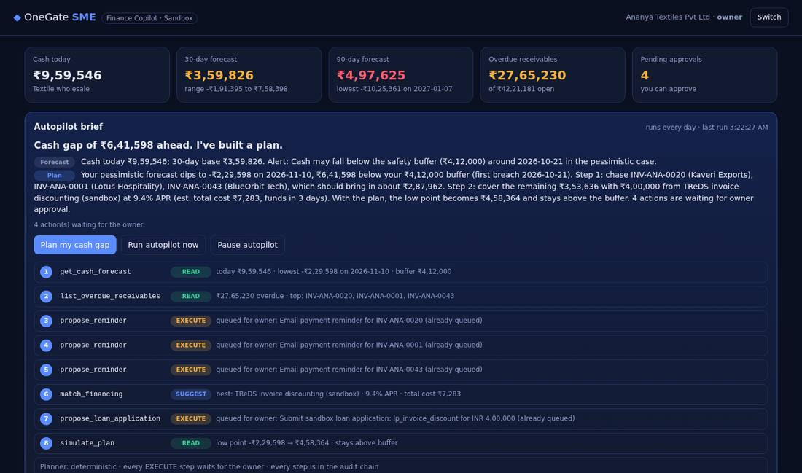
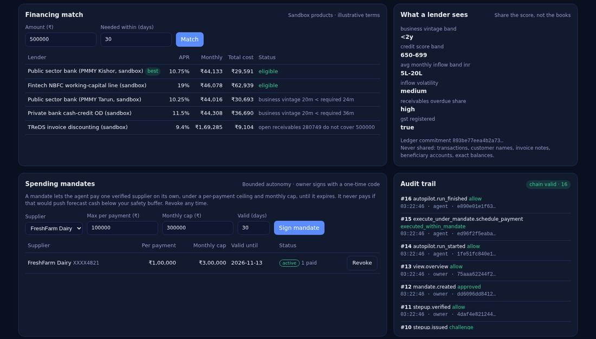

<div align="center">

# OneGate SME

### An AI finance agent for small businesses: it plans, chases and pays, but only inside limits the owner signs

**FinTechathon 2026 · International Track · Topic E: SME Finance Copilot · Team GateKeepers**

[](#-tests)
[](backend/tests)
[](https://nodejs.org/)
[](docs/sandbox-evidence/SUMMARY.md)
[](docs/SECURITY_SELF_ASSESSMENT.md)

[Submission index](docs/submission/SUBMISSION.md) ·
[Technical docs](docs/TECHNICAL_DOCUMENTATION.md) ·
[Security self-assessment](docs/SECURITY_SELF_ASSESSMENT.md) ·
[Execution evidence](docs/sandbox-evidence/SUMMARY.md) ·
[Agentic layer](docs/AGENTIC_COPILOT.md) ·
[Deck and PDFs (Drive)](https://drive.google.com/drive/folders/1sksHP-oYGp0sC7nAqAZzvl535y9GnbHF)



</div>

---

## The problem

A small business owner in India finds out about a cash crunch when a payment bounces. Overdue invoices sit in a spreadsheet, credit options are hard to compare on total cost, and any AI that can "just pay the supplier" is one forged invoice note away from paying a scammer.

## AI as a financial participant, in 30 seconds

Ask *"plan how I get through the cash gap"* (or let the daily autopilot notice it first). The agent:

1. **forecasts** cash and finds the gap: Ananya Textiles dips **₹6,41,598** below its buffer by 10 Nov 2026
2. **ranks** debtors by risk-weighted value and **queues reminders** for the three that close most of the gap
3. **sizes what's left** and **matches financing** that lands before the breach (TReDS discounting, 9.4% APR, ₹7,283 total cost)
4. **queues the loan application**, sharing only banded features with the lender, never the ledger
5. **re-simulates** the forecast with the plan applied: the low point moves from **-₹2,29,598 to ₹4,58,364**

Every step is a guarded tool call you can see on screen and in the audit chain. Steps that move money or contact customers wait for the owner, who approves with the exact amount and a one-time code. For small recurring bills the owner can sign a **spending mandate**, and the autopilot pays them on its own, but never when that would push forecast cash below the buffer. Details: [`docs/AGENTIC_COPILOT.md`](docs/AGENTIC_COPILOT.md).

| Agentic capability | How it works |
|---|---|
| 🧭 **Multi-step planning** | Goal → 8 chained tool calls → one plan with approval cards and a before/after simulation |
| 🤖 **LLM tool-calling (optional)** | Any OpenAI-compatible model picks the next tool from a fixed registry. A **grounding check** rejects any ₹ amount not found in a tool result and falls back to the deterministic planner |
| ⏰ **Autopilot** | Runs daily without being asked: re-forecasts, pays mandated bills, escalates the rest, plans gaps, writes a morning brief. Owner can pause it instantly |
| ✍️ **Spending mandates** | Bounded autonomy: one verified payee, ≤ ₹2,00,000 per payment, ≤ ₹5,00,000 a month, ≤ 90 days, revocable, signed with a one-time code |
| 🔐 **Step-up codes** | Payments, loan applications and mandates need a 6-digit code bound to that action and amount (5 min, 3 tries, single use) |
| 🫥 **Share the score, not the books** | A lender sees 6 banded features and a SHA-256 ledger commitment, never transactions, customer names or balances |



## What OneGate SME does

| | Task | What the owner gets |
|---|---|---|
| 📈 | **Forecast cash** | Daily low / base / high path for 30, 60 and 90 days, the lowest point, and an alert when cash will dip below the safety buffer |
| 🧾 | **Rank receivables** | Ageing buckets, a 0–100 risk score per invoice, and the order to chase them in |
| ✉️ | **Chase a payment** | A ready reminder draft. It goes to the (sandbox) customer only after the owner approves |
| 🏦 | **Match financing** | Five products (PMMY Tarun and Kishor, cash credit, TReDS, NBFC line) ranked by **total cost**, each with the reason it fits or doesn't |
| 💸 | **Pay a supplier / apply for a loan** | Becomes an approval card. Nothing executes until the owner re-types the exact amount and enters a one-time code |
| 🛡️ | **Refuse attacks** | Prompt injections hidden in invoice notes and phishing "bank details changed" emails are flagged, blocked and logged |

## Why it's safe: authority comes from policy, not from language

The copilot can say anything; it can only **do** what the policy engine allows. Every request passes three server-side checks before any tool runs: tenant membership, `:tid` matches the caller's tenant, then `policy.evaluate(action, role, params)`.

| Tier | Actions | Who |
|---|---|---|
| **READ** | Overview, forecast, receivables, financing | owner, accountant, viewer |
| **SUGGEST** | Draft a reminder, recommend financing | owner, accountant |
| **EXECUTE** | Send reminder, schedule payment, submit loan application, sign or revoke a mandate | owner, accountant or the autopilot agent *propose*; **only the owner approves** |
| **DENY** | Add a beneficiary, change bank details, disable audit | nobody, ever, through OneGate |

**Hard limits on EXECUTE:** ₹5,00,000 per payment · ₹8,00,000 per tenant per day · verified beneficiaries only · exact-amount re-confirmation · one-time code bound to the action · policy re-checked at approval · 24 h expiry · idempotency keys · warning when a payment would push forecast cash below the buffer. The autopilot agent has its own identity and **can never approve**, even its own proposals.

**Every** proposal, decision, denial, blocked attack and execution lands in a per-tenant **SHA-256 hash chain**. `GET /api/sme/:tid/audit/verify` finds the first altered entry.

In red-team testing, even messages the detector was built to miss moved **no money**, because language never carries authority.

## Results on three synthetic SMEs

Walk-forward backtest of the 30-day forecast, plus the scripted sandbox run ([full evidence](docs/sandbox-evidence/SUMMARY.md)):

| SME | Profile | Forecast MAPE (30 d) | Attacks blocked | Policy denials | Owner-approved payment (amount + code) | Agent plan | Autopilot + mandate | Audit chain |
|---|---|---|---|---|---|---|---|---|
| Chai Point Cafe | Retail café, steady sales | **3.93%** | 2/2 | 3/3 | executed after approval | no gap, nothing proposed | paid ₹22,400 inside mandate | valid |
| PixelForge Design Studio LLP | B2B services, lumpy invoices | **7.89%** | 2/2 | 3/3 | executed after approval | no gap in 45 days | paid ₹18,500 inside mandate | valid |
| Ananya Textiles Pvt Ltd | Wholesale, slow payers | **26%** | 2/2 | 3/3 | executed after approval | 8 tool steps, 4 approval cards | **refused to auto-pay** (would breach buffer), escalated | valid |

Ananya's error is the honest one: slow, irregular payers are hard to forecast, which is exactly why the copilot shows a low–high band and a buffer alert instead of a single number.

## Run it in two minutes

Requires Node.js 18+ (20 recommended). No API keys or secrets are needed for the SME demo.

```bash
git clone https://github.com/TarrushSaxena/OneGate.git
cd OneGate/backend
npm install
npm run provision:demo        # creates demo users, prints a one-time password
npm start                     # open http://localhost:3000/sme.html
```

On the sign-in screen pick a demo user (development mode only, see [`DEMO_ACCESS.md`](DEMO_ACCESS.md)):

| User | Role | Try this |
|---|---|---|
| `owner.ananya@company.com` | owner | Press **Plan my cash gap**, then approve a payment with the amount and the one-time code |
| `accounts.ananya@company.com` | accountant | Propose a payment, then see that you can't approve it |
| `viewer.pixelforge@company.com` | viewer | Read-only: every action button is gone |
| `owner.chai@company.com` | owner | Sign a mandate for FreshFarm Dairy, press **Run autopilot now** and watch it pay the bill on its own. Other tenants' data is refused |

Then press **Try an attack** in the copilot chat.

### Demo script (3 minutes)

1. **(0:00)** Sign in as the Ananya owner. The autopilot brief already says *"Cash gap of ₹6,41,598 ahead. I've built a plan."*
2. **(0:20)** Press **Plan my cash gap**. Watch 8 tool calls run: forecast, debtors, three reminders, financing, loan application, simulation. The low point goes from -₹2,29,598 to ₹4,58,364.
3. **(1:00)** In Approvals, approve the loan application: press Approve, type the one-time code (shown as a sandbox SMS). Its receipt carries a consent artefact and shows what the lender saw.
4. **(1:30)** Press **Try an attack**. It's blocked before any model runs and logged in the audit chain.
5. **(1:50)** Switch to Chai Point. Sign a mandate for FreshFarm Dairy (code again), press **Run autopilot now**: it pays the ₹22,400 bill on its own and drafts two reminders for approval. Back on Ananya, the same autopilot **refuses** to auto-pay because cash would breach the buffer.
6. **(2:30)** Revoke the mandate, pause the autopilot, show the audit chain is valid.

## 🧪 Tests

```bash
cd backend
node tests/run-all-tests.js   # 43 suites, including 46 SME tests
```

SME suites: `sme-01-core` (forecast, receivables, financing, policy, guards, audit chain), `sme-02-api` (tenancy, tiers, approvals with step-up codes, limits over HTTP), `sme-03-secret-hygiene` (no keys or passwords in the tree), `sme-04-agent` (multi-step planner, LLM tool-calling guardrails with a scripted model: grounding fallback, refused tools, injection blocked before the model, API failure; step-up codes; mandates; autopilot escalation, no double payment, kill switch; lender data minimisation).

## API

| Method | Endpoint | Tier |
|---|---|---|
| `GET` | `/api/sme/:tid/overview` | READ |
| `GET` | `/api/sme/:tid/forecast` | READ |
| `GET` | `/api/sme/:tid/receivables` | READ |
| `GET` | `/api/sme/:tid/receivables/:invoiceId/draft` | SUGGEST |
| `POST` | `/api/sme/:tid/financing/match` | SUGGEST |
| `POST` | `/api/sme/:tid/copilot` | LLM agent if configured, else routed per intent |
| `POST` | `/api/sme/:tid/agent/plan` | SUGGEST (proposals queue as EXECUTE) |
| `GET` | `/api/sme/:tid/agent/tools` | READ: the tool registry the agent can use |
| `GET` · `POST` | `/api/sme/:tid/autopilot` · `/autopilot/run` · `/autopilot/pause` | READ · SUGGEST · owner |
| `GET` · `POST` | `/api/sme/:tid/mandates` · `/mandates/challenge` · `/mandates` · `/mandates/:id/revoke` | owner + one-time code |
| `POST` | `/api/sme/:tid/actions/:id/stepup` | owner: one-time code for this action |
| `GET` | `/api/sme/:tid/privacy/lender-share` | SUGGEST |
| `POST` | `/api/sme/:tid/actions` | EXECUTE (propose) |
| `POST` | `/api/sme/:tid/actions/:id/approve` · `/reject` | owner only |
| `GET` | `/api/sme/:tid/audit` · `/audit/verify` | READ |

## Architecture


**Fallbacks:** LLM timeout, unparseable output, an unknown tool or an ungrounded amount → deterministic planner (logged as `agent.llm_fallback`). No LLM key → deterministic planner by default. Mandate check fails → normal approval card. Autopilot paused → run skipped and logged.

| File (`backend/sme/`) | Role |
|---|---|
| `data/sandbox.js` | Deterministic synthetic data: 3 SMEs, 180 days of transactions, invoices, payables, verified beneficiaries, 5 loan products |
| `forecast.js` | Cash forecaster and walk-forward backtest |
| `receivables.js` | Ageing, risk ranking, reminder drafts |
| `financing.js` | Explainable eligibility and total-cost matching |
| `guard.js` | Prompt-injection and phishing detection, PII redaction |
| `policy.js` | Permission tiers, role matrix, hard limits |
| `tenancy.js` | Tenant membership and SME roles |
| `actions.js` | Propose / approve / reject, idempotency, sandbox execution |
| `auditChain.js` | Tamper-evident audit trail |
| `copilot.js` | Entry point: guards first, then the LLM agent or the deterministic intent router |
| `agent.js` | Tool registry, multi-step cash-gap planner, what-if simulation, LLM tool-calling loop with grounding check |
| `autopilot.js` | Scheduled monitoring runs, morning brief, kill switch |
| `mandates.js` | Owner-signed spending mandates (bounded autonomy) |
| `stepup.js` | One-time codes bound to an action and amount |
| `privacy.js` | Lender share: banded features + ledger commitment |

## Compliance alignment (indicative, not certified)

- **RBI Digital Lending Directions:** loan applications need the borrower's explicit approval, with APR and total cost shown first.
- **DPDP Act 2023:** PII minimised in logs and in model prompts, tenant data isolated, lenders get derived features only (purpose limitation, data minimisation).
- **RBI Account Aggregator framework:** each loan application carries a purpose-bound, time-boxed, revocable consent artefact.
- **NPCI e-mandate / UPI AutoPay pattern:** autonomous payments only under an owner-registered mandate with a cap, a validity period and revocation.
- **CERT-In:** timestamped, tamper-evident decision log.

## Known limits and what's next

In-memory state, a static membership table, rule-based injection detection, sandbox delivery of one-time codes (shown on screen; a real deployment sends them by SMS or uses a passkey), planning assumptions for reminder recovery (60% of probability-weighted value within 7 days, stated in every plan), and a scenario band rather than a calibrated interval. Federated learning is described, not built. Next: persistent append-only storage, passkeys, a calibrated forecast interval, real Account Aggregator connectors, TReDS and lender APIs, a federated credit model across lenders (FATE), and Docker Compose deployment. Details in the [security self-assessment](docs/SECURITY_SELF_ASSESSMENT.md).

## Repository layout

```
OneGate/
├── backend/
│   ├── sme/             # SME Finance Copilot (this submission)
│   ├── tests/           # 43 suites, sme-01..04 are the SME ones
│   ├── auth/ routes/ services/ ml/   # OneGate platform core (auth, audit, sessions)
│   └── server.js
├── frontend/
│   ├── sme.html sme.js sme.css   # SME dashboard and copilot
│   └── ...                       # platform UI
├── docs/
│   ├── submission/      # FinTechathon checklist index and deck outline
│   ├── TECHNICAL_DOCUMENTATION.md
│   ├── SECURITY_SELF_ASSESSMENT.md
│   ├── SME_COPILOT.md
│   ├── AGENTIC_COPILOT.md   # planner, LLM guardrails, autopilot, mandates, privacy
│   ├── architecture.svg
│   ├── sandbox-evidence/   # run log, per-SME audit chains, screenshot
│   └── helpdesk/        # docs for the underlying OneGate helpdesk platform
├── DEMO_ACCESS.md  SECURITY.md  .env.example
└── package.json
```

## Built on the OneGate platform

OneGate SME reuses the security core of **OneGate**, our enterprise AI helpdesk (DistilBERT routing across 11 departments, PII redaction, RBAC, SLA escalation). Its documentation lives in [`docs/helpdesk/`](docs/helpdesk/README.md).

## Team GateKeepers, Bennett University, India

| Member | Role |
|---|---|
| **Tarrush Saxena** (Lead) | Product, copilot design, pitch |
| **Yogya Mittal** | Forecasting and financing logic |
| **Utkarsh Gupta** | Backend, policy engine, security |

All data in this repository is synthetic. No real money or messages leave the sandbox. Report security issues as described in [`SECURITY.md`](SECURITY.md).
