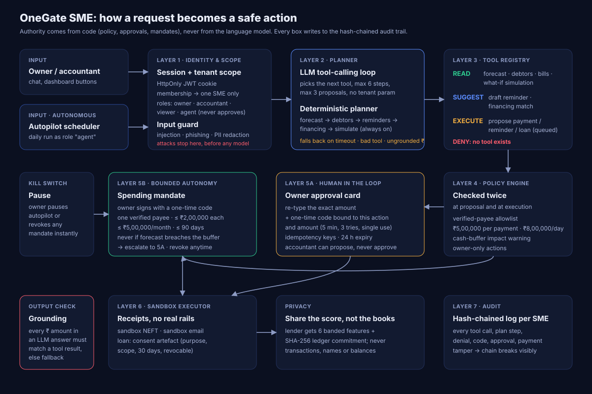

# OneGate SME: the agentic layer

**AI as a financial participant, with authority that comes from code.**
Version 1.2 · 14 Oct 2026 · Team GateKeepers · Topic E: SME Finance Copilot

The first version of OneGate SME answered questions and proposed one action at a time. Version 1.2 makes the agent a participant: it plans several steps toward a goal, works on a schedule without being asked, and pays small recurring bills on its own inside a mandate the owner signed. None of that widens what language can do. The model chooses *which* tool to call. Policy, approvals, mandates and the audit chain decide *what happens*.



---

## 1. Multi-step planner (`backend/sme/agent.js`)

**Goal:** "get me through the cash gap". The planner chains registered tools and returns one plan:

| Step | Tool | Tier | What it does |
|---|---|---|---|
| 1 | `get_cash_forecast` | READ | Finds the pessimistic low point and the first buffer breach |
| 2 | `list_overdue_receivables` | READ | Ranks debtors by risk-weighted value, with each customer's historical pay probability |
| 3–5 | `propose_reminder` ×≤3 | EXECUTE (queued) | Picks the debtors whose expected recovery closes most of the gap, and queues reminders for approval |
| 6 | `match_financing` | SUGGEST | Sizes the remaining gap (rounded up to ₹50,000) and matches products that disburse before the breach, ranked by total cost |
| 7 | `propose_loan_application` | EXECUTE (queued) | Queues the cheapest eligible application for approval |
| 8 | `simulate_plan` | READ | Re-runs the forecast with expected collections and the loan applied, and reports the low point before and after |

**Result on Ananya Textiles (sandbox, 12 Oct 2026):** gap ₹6,41,598 (first breach 21 Oct); three reminders worth about ₹2,87,962 expected; ₹4,00,000 TReDS invoice discounting at 9.4% APR (est. total cost ₹7,283, 3-day disbursal); the low point moves from **-₹2,29,598 to ₹4,58,364** and stays above the ₹4,12,000 buffer.

**Planning assumptions** are returned with every plan so the owner can challenge them: a reminder recovers 60% of the probability-weighted invoice value within 7 days; at most 3 reminders per plan; financing rounded up to ₹50,000. Loan repayments after the horizon are not yet modelled in the simulation.

**Properties:** deterministic and reproducible; idempotent (re-planning on the same day returns the same approval cards instead of duplicates); nothing executes; every step is an audit entry `agent.tool.<name>`.

## 2. LLM tool-calling, with a grounding firewall

When `SME_LLM_API_KEY` (or `ZENMUX_API_KEY`) is set, `POST /api/sme/:tid/copilot` runs a tool-calling loop over the **same registry** with any OpenAI-compatible model:

```
system: tools + rules  →  model: {"tool": "...", "args": {...}}  →  server runs the tool  →  TOOL_RESULT
        …up to 6 steps…  →  model: {"final": "..."}  →  grounding check  →  reply
```

| Guardrail | Enforced where |
|---|---|
| Guards run **before** the model: injections and phishing never reach it | `copilot.respond()` |
| The model never names a tenant: tools are closures bound to the caller's tenant | `makeTools(tenantId, actor)` |
| Unknown tool names are refused (no DENY action exists as a tool) | `runLLM()` allowlist |
| Viewers can only use READ tools; at most 3 EXECUTE proposals per run | `runLLM()` |
| EXECUTE tools only **queue** an action; approval is a separate owner-only API with amount re-type and a one-time code | `actions.propose()` / `decide()` |
| Tool results are PII-redacted and truncated before they go back to the model; invoice notes are withheld | `redactPII`, `receivables()` |
| **Grounding check:** every amount ≥ 1,000 in the final answer must match (within 1%) a number from a tool result or the user's message, or the answer is discarded | `groundingCheck()` |
| Any failure (timeout, bad JSON, step budget, ungrounded number) falls back to the deterministic path, logged as `agent.llm_fallback` with the reason | `copilot.respond()` |

Without a key, the deterministic planner and intent router answer everything, so the demo needs no secrets. The guardrails are tested with a scripted fake model in `sme-04-agent.test.js`: grounded answer accepted, invented ₹98,76,543 rejected, `add_beneficiary` refused, injection blocked with **zero** model calls, API failure falls back.

## 3. Autopilot (`backend/sme/autopilot.js`)

Runs daily (`SME_AUTOPILOT_INTERVAL_MIN`, default 1440; first run shortly after boot) and on demand (`POST /autopilot/run`). For each SME it:

1. re-forecasts and reads alerts;
2. tries to pay each open bill under a mandate, and turns every refusal into an approval card with the reason;
3. if a gap is coming, runs the multi-step planner; otherwise queues reminders for invoices over 30 days late with risk ≥ 60;
4. writes a **morning brief** (headline, events, approvals waiting) shown at the top of the dashboard.

It acts as its own identity, `sme_role: "agent"`: it can read, suggest and propose, and it **can never approve**, not even its own proposals (tested). The owner can pause it (`POST /autopilot/pause`); paused runs are skipped and logged.

## 4. Spending mandates: bounded autonomy (`backend/sme/mandates.js`)

A mandate is a programmable spending policy, the same idea as an e-mandate or UPI AutoPay registration, applied to an AI agent.

| Rule | Value |
|---|---|
| Who can sign or revoke | owner only, signing needs a one-time code |
| Payee | exactly one beneficiary already on the verified allowlist |
| Per payment | ≤ owner's ceiling, hard max ₹2,00,000 |
| Monthly cap | ≤ owner's cap, hard max ₹5,00,000 |
| Validity | 1–90 days, revocable at any time |
| What it can pay | an open bill from that payee, due within 3 days |
| Cash safety | **never** if the 30-day pessimistic forecast is below the safety buffer; escalates instead |
| Platform limits | still applied: ₹5,00,000 per payment, ₹8,00,000 per day, DENY list |

**Sandbox results:** Chai Point (healthy cash) — the autopilot paid ₹22,400 to FreshFarm Dairy under the mandate, and a second run did not pay twice. Ananya (cash gap) — the autopilot **refused** to auto-pay the ₹48,000 freight bill and sent it to the owner, because the forecast already breaches the buffer.

## 5. Step-up codes (`backend/sme/stepup.js`)

Approving a payment or loan application, and signing a mandate, needs a 6-digit code on top of the session. A code is bound to one tenant, one user, one action and one amount; stored only as a salted SHA-256 hash; valid for 5 minutes; 3 attempts; single use; compared in constant time. In the sandbox the code is returned as a "sandbox SMS" so the demo runs anywhere; set `SME_STEPUP_DELIVERY=sms` to stop returning it. A stolen session alone can no longer approve anything.

## 6. Privacy: share the score, not the books (`backend/sme/privacy.js`)

When a loan application executes, the lender receives:

- six **banded** features: business vintage, credit-score band, average monthly inflow band, inflow volatility, overdue-receivables share, GST registration;
- a **SHA-256 commitment** to the ledger they were computed from, so an auditor can later prove the features came from the books the SME held at consent time;
- a **consent artefact** modelled on the RBI Account Aggregator framework: purpose `loan_underwriting`, data scope, 30-day validity, revocable.

Never shared: transactions, customer names, invoice notes, beneficiary accounts, exact balances. The owner sees exactly this view in the dashboard ("What a lender sees").

**Federated next step (designed, not built).** Banded features let one lender decide on one SME. To *improve* the model behind those decisions without pooling SME ledgers, lenders and the platform can train a shared risk model with horizontal federated learning (for example WeBank's open-source **FATE**): each party trains on its own repayment outcomes, only encrypted gradient updates are aggregated, and no raw ledger leaves its owner. OneGate's role would be the consented feature extractor on the SME side.

## 7. Threat model additions for an acting agent

| Threat | Control | Test |
|---|---|---|
| Model invents a number | Grounding check, deterministic fallback | `sme-04` invented-number test |
| Model calls a dangerous capability | No such tool; allowlist refuses unknown names | `sme-04` refused-tool test |
| Injection steers the model | Guards before the model; notes withheld; tool output is data | `sme-04` zero-model-calls test |
| Agent approves its own action | `agent` role can never approve | `sme-04` self-approval test |
| Runaway autonomy | Mandate caps, expiry, cash-buffer rule, revoke, pause | `sme-04` escalation, no-double-pay, kill-switch tests |
| Stolen session approves a payment | One-time code bound to action and amount | `sme-02`, `sme-04` step-up tests |
| Lender over-collection | Banded features + commitment only | `sme-04` lender-share test |

## 8. Try it

```bash
cd backend && npm install && npm run provision:demo && npm start
# http://localhost:3000/sme.html
```

Ananya owner → **Plan my cash gap** → approve the loan (code shown as sandbox SMS). Chai Point owner → sign a mandate for FreshFarm Dairy → **Run autopilot now**. Optional: `SME_LLM_API_KEY=... SME_LLM_MODEL=... npm start` to switch the copilot to LLM tool-calling.
